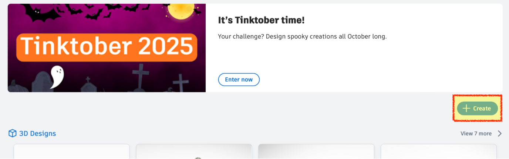
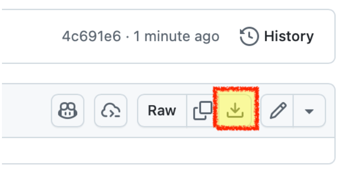
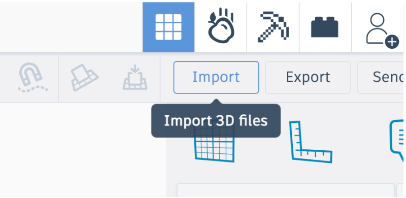
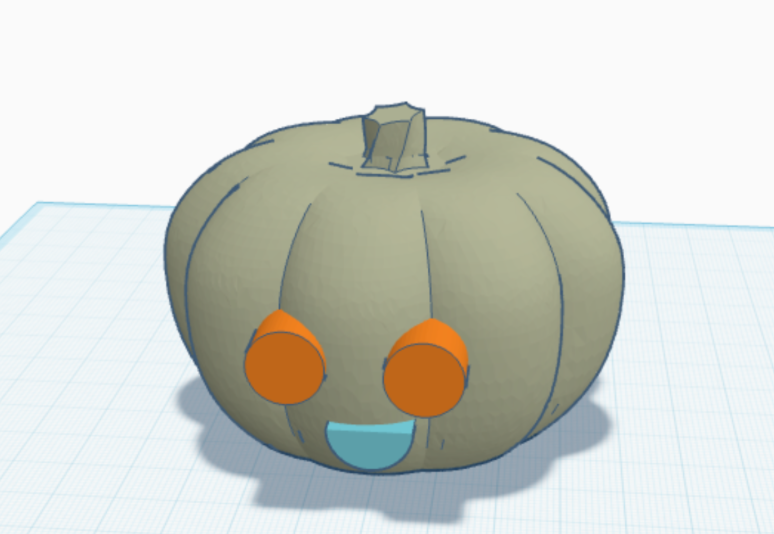
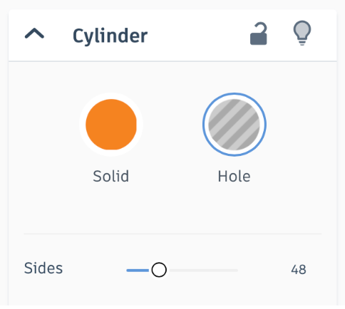
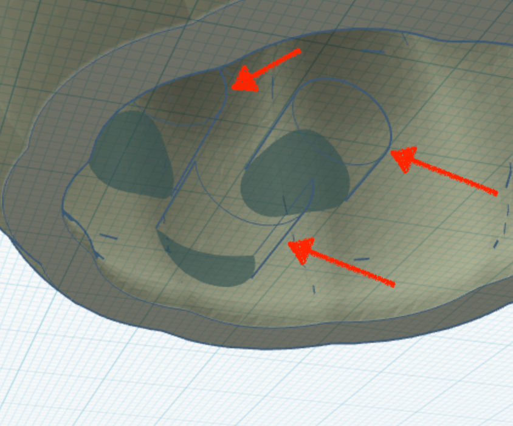
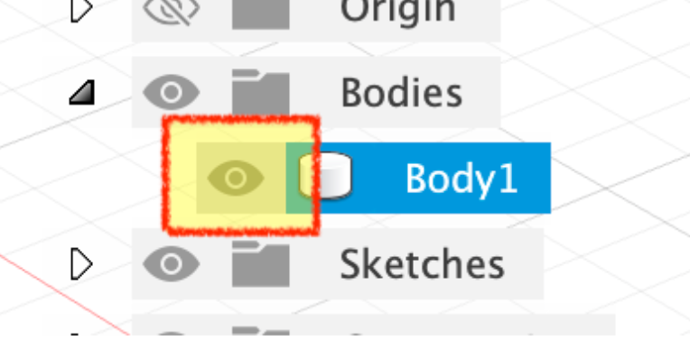
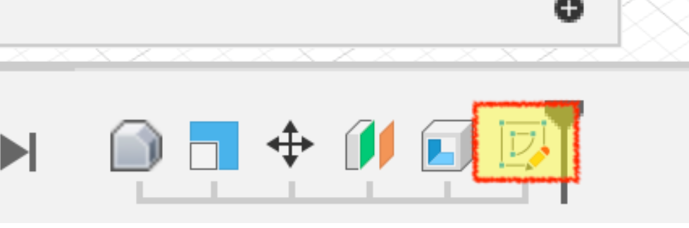
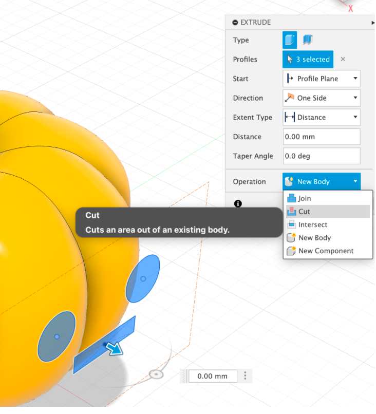

# C03 - Halloween Pumpkin CAD Carving (Tinkercad & Fusion)

### Step-by-Step interactive guide

### by Charlie Kingsland

- Press `space` or `right arrow` to go to the next step
- Press `escape` to get a slide overview

Choose between either:

- Tinkercard [slide 2](#2)
- Fusion [slide 6](#6)

---

## Tinkercad pt. 1

1. Sign into [Tinkercad](https://www.tinkercad.com/)
2. Create a new 3D design project

---

## Tinkercad pt. 2

1. Download `Pumpkin_tinkercad.stl` from [GitHub](https://github.com/rhulmakerssoc/halloween-workshop/raw/refs/heads/main/Pumpkin_tinkercad.stl)

4. In the top-right, press **Import** and select the downloaded `stl` (leave all settings as they are)

---

## Tinkercad pt. 3

5. Add in all of your shapes that you would like to make the design

6. Select all of your added in shapes, and in the panel in the top-right, change it from **Solid** to **Hole**

---

## Tinkercad pt. 4

7. Rotate the view to underneath, and make sure you can see all of the extruded shapes inside the inside the pumpkin (this means they will be fully extruded and 'carve' the pumpkin)

8. Go to `Export > STL`, Ta-da! You have a pumpkin, export it and [email it to us](mailto:makers@royalholloway.su) - we will let you know what colours we have in the lab :)

---

## Fusion pt. 1

1. Open and login to Fusion with your student Autodesk account (refer back to the [Fusion introduction workshop](https://docs.google.com/viewerng/viewer?url=https://drive.usercontent.google.com/download?id%3D17DfQbfLrG5M7RBt3flyoxVKxe2yLPsYz) if you need to create an account)
    Download the `Pumpkin_fusion.f3d` from [GitHub](https://github.com/rhulmakerssoc/halloween-workshop/raw/refs/heads/main/Pumpkin_fusion.f3d)

1. Open the downloaded file in Fusion

---

## Fusion pt. 2

3. Once opened, hide the pumpkin model by clicking on the eye symbol next to `Body1`

4. To add your design, double click on the sketch in the timeline along the bottom

---

## Fusion pt. 3

5. Use the skills you learnt in the Fusion introduction workshop to sketch your design (Ask a committee member or refer back to the lab sheet). Ensure that your design stays within the construction rectangle that is already in the sketch for you
6. When you have finished your sketch, unhide the pumpkin model
7. Go to `Create > Extrude`, and select your sketch

---

## Fusion pt. 4

8. In the panel that has appeared, change `Operation` to `Cut`

9. Set `Distance` to `-20mm`
10. Ta-da! You have a pumpkin, export it and [email it to us](mailto:makers@royalholloway.su) - we will let you know what colours we have in the lab
